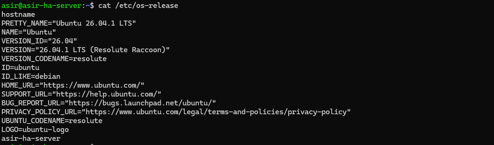
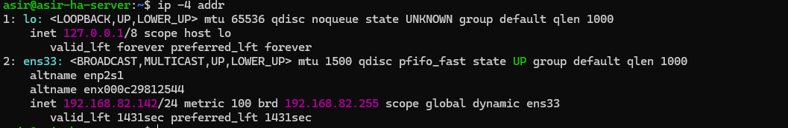
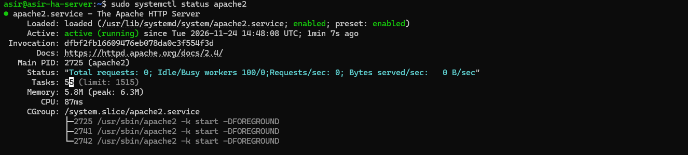
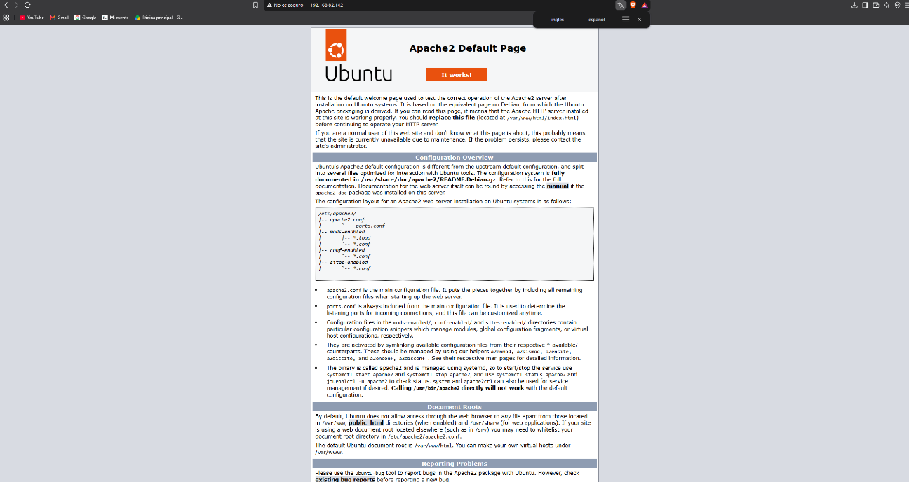
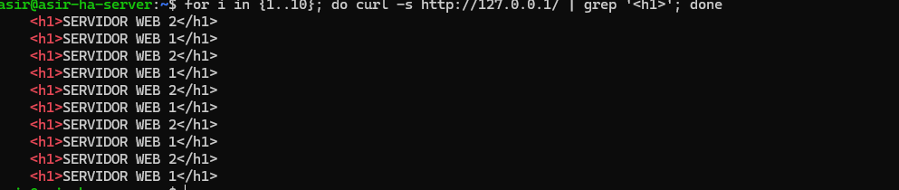
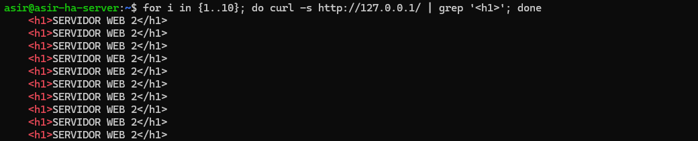
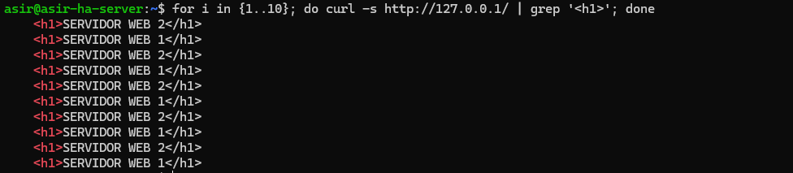

[README.md](https://github.com/user-attachments/files/35348064/README.md)
# Alta disponibilidad y balanceo de carga con Apache2

**Laboratorio de ASIR · Seguridad y Alta Disponibilidad · Ubuntu Server**

En este proyecto he configurado **Apache2 como reverse proxy y load balancer** delante de dos servicios web independientes. He comprobado cómo se reparten las solicitudes HTTP, qué sucede al detener uno de los servicios y cómo vuelve a participar en el balanceo tras recuperarlo.

> **Alcance:** es una demostración de tolerancia al fallo de **un backend**, no una infraestructura de alta disponibilidad completa. Apache2 y ambos servicios se ejecutaron en **la misma máquina virtual**, que sigue siendo un *single point of failure* (SPOF).

## Entorno utilizado

| Componente | Configuración utilizada |
|---|---|
| Hipervisor | VMware Workstation Pro |
| Sistema operativo | Ubuntu Server 26.04.1 LTS |
| Máquina virtual | `Ubuntu-PAC-HA` |
| Hostname | `asir-ha-server` |
| Recursos | 3 GB RAM · 2 núcleos CPU · 25 GB disco |
| Red | NAT; IP observada en el laboratorio `192.168.82.142/24` (DHCP) |
| Proxy y balanceador | Apache2, puerto 80 |
| Backend 1 | Python `http.server` en `127.0.0.1:8081` |
| Backend 2 | Python `http.server` en `127.0.0.1:8082` |




## Arquitectura

```text
Cliente HTTP (puerto 80)
          |
          v
 Apache2 · reverse proxy / load balancer
          |
          +----> Web 1 · 127.0.0.1:8081
          |
          +----> Web 2 · 127.0.0.1:8082
```

Las dos páginas identifican al servidor que responde. No configuré sincronización de datos ni servidores en hosts diferentes: son dos backends sencillos para comprobar el comportamiento del balanceador.

## 1. Preparación de Apache2

Actualicé la información de paquetes e instalé Apache2:

```bash
sudo apt update
sudo apt install apache2 -y
systemctl status apache2
```

Comprobé que el servicio estaba activo y que podía acceder a su página inicial desde el navegador.




## 2. Configuración de los dos servidores web

Creé los directorios `/home/asir/web1` y `/home/asir/web2` y sus archivos `index.html`. Las páginas utilizadas están disponibles en [`web1/index.html`](web1/index.html) y [`web2/index.html`](web2/index.html).

Inicié cada servidor Python en una terminal SSH independiente; los procesos permanecían activos mientras esas terminales seguían abiertas:

```bash
python3 -m http.server 8081 --bind 127.0.0.1 --directory /home/asir/web1
```

```bash
python3 -m http.server 8082 --bind 127.0.0.1 --directory /home/asir/web2
```

Comprobé por separado ambos puertos:

```bash
curl http://127.0.0.1:8081
curl http://127.0.0.1:8082
```

| Web 1 (8081) | Web 2 (8082) |
|---|---|
|  |  |

## 3. Configuración del balanceador

Habilité los módulos necesarios:

```bash
sudo a2enmod proxy proxy_http proxy_balancer lbmethod_byrequests
```

Creé el Virtual Host [`apache/balanceador.conf`](apache/balanceador.conf) y definí ambos backends dentro de `balancer://webcluster`. Utilicé el método `byrequests` para repartir las solicitudes entre ellos.

```apache
<Proxy "balancer://webcluster">
    BalancerMember "http://127.0.0.1:8081"
    BalancerMember "http://127.0.0.1:8082"
    ProxySet lbmethod=byrequests
</Proxy>
ProxyPass "/" "balancer://webcluster/"
ProxyPassReverse "/" "balancer://webcluster/"
```

Habilité el sitio, deshabilité el predeterminado, comprobé la sintaxis y reinicié Apache2:

```bash
sudo a2ensite balanceador.conf
sudo a2dissite 000-default.conf
sudo apache2ctl configtest
sudo systemctl restart apache2
systemctl is-active apache2
```

Obtuve `Syntax OK` en la validación y `active` al consultar el estado del servicio. Después comprobé que una solicitud a `http://127.0.0.1/` respondía con la página de uno de los backends. Es decir, el cliente accedía a **Apache por el puerto 80**, no directamente a los puertos 8081/8082.

## 4. Prueba de balanceo de carga

Ejecuté diez peticiones consecutivas al balanceador:

```bash
for i in {1..10}; do curl -s http://127.0.0.1/ | grep '<h1>'; done
```

En esta prueba observé **cinco respuestas de Web 1 y cinco de Web 2**. Esto confirma el reparto de solicitudes durante la prueba; no implica que el algoritmo garantice una alternancia exacta en todas las circunstancias.



## 5. Simulación de fallo y continuidad del servicio

Detuve el proceso Python de **Web 1** mediante `Ctrl + C` en su terminal. Después comprobé que el puerto 8081 no aceptaba conexiones:

```bash
curl http://127.0.0.1:8081
```

La prueba mostró `curl: (7) Failed to connect`.


Volví a ejecutar diez peticiones contra **Apache (puerto 80)** y obtuve **diez respuestas de Web 2**, por lo que el servicio siguió disponible a través del backend restante.



## 6. Recuperación

Reinicié el servidor Python de Web 1:

```bash
python3 -m http.server 8081 --bind 127.0.0.1 --directory /home/asir/web1
```

Repetí las diez solicitudes al balanceador. En la captura se aprecia que ambos backends volvieron a responder, **cinco peticiones cada uno**.



## 7. Procedimiento ante incidencias

A partir de la simulación, documenté un procedimiento de respuesta: detectar el servicio que falla; comprobar cada puerto de backend con `curl`; verificar que Apache continúa sirviendo peticiones; analizar el estado del proceso y, cuando sea necesario, sus logs; recuperar el backend; repetir las pruebas; y registrar el incidente y el resultado. La revisión de logs forma parte del procedimiento propuesto y **no se presenta como una prueba ejecutada**.

## Limitaciones y posibles mejoras

- **Punto único de fallo:** Apache2 y ambos backends comparten una única VM. Una caída de la VM o del proxy podría interrumpir el acceso al servicio.
- **Procesos manuales:** los servicios Python se iniciaron en terminales SSH, sin configuración de arranque automático ni supervisión con `systemd`.
- **Mejora propuesta, no implementada:** separar los backends en máquinas independientes y desplegar balanceadores redundantes con failover, por ejemplo Keepalived e IP virtual.

## Qué he aprendido

Esta práctica me ha permitido comprobar con resultados reales la diferencia entre **repartir carga** y **mantener la disponibilidad cuando falla un backend**. También he identificado que la redundancia de servicios no elimina por sí sola los puntos únicos de fallo de la infraestructura.

---

*Proyecto realizado como práctica del Grado Superior de Administración de Sistemas Informáticos en Red (ASIR). Todas las capturas proceden de las pruebas efectuadas durante el laboratorio.*
